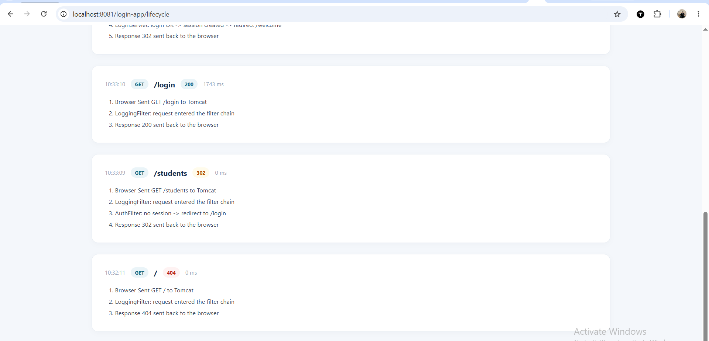

# NTI Learning Hub

A Java web application built to practice the full **HTTP request lifecycle**: from the URL a user types, through a filter chain, servlets, a DAO layer and MySQL, to a JSP response. Built during the NTI SOA & Microservices program (Jakarta EE, Servlets, JSP, JDBC).

## Features

- **Register / Login / Logout** with sessions
- **BCrypt** password hashing (cost 12), no plain-text passwords
- **AuthFilter** protecting `/welcome`, `/students` and `/lifecycle`
- **Students management**: add, list, delete (JDBC + MySQL)
- **Post/Redirect/Get** after every state-changing request
- **LoggingFilter + `/lifecycle` page**: the app shows, step by step, how each request travelled through it
- **DAO pattern**: `UserDao` with in-memory and JDBC implementations; the servlets never know which one is used

## Tech stack

Java 17 · Jakarta EE 10 (Servlet 6, JSP, JSTL) · Apache Tomcat 10.1 · Maven · MySQL · JDBC · jBCrypt

## Screenshots

| Login | Register |
|---|---|
|  |  |

| Welcome | Students |
|---|---|
|  |  |

### The request lifecycle page


A request to `/students` without a session is stopped by `AuthFilter` and redirected to `/login` (HTTP 302):



Passwords are stored as BCrypt hashes:


## HTTP request lifecycle

```
Browser
   | HTTP request (GET /students)
   v
Tomcat (servlet container)
   v
LoggingFilter   -> records every step of the request
   v
AuthFilter      -> no session? redirect to /login (302)
   v
StudentServlet  -> GET: list, POST: add / delete
   v
StudentDao  (interface)
   v
JdbcStudentDao  -> PreparedStatement -> MySQL
   v
StudentServlet  -> request attribute + RequestDispatcher.forward()
   v
students.jsp    -> EL + JSTL render the HTML
   v
HTTP response -> Browser
```

## Project structure

```
src/main/java/com/nti/hub/
  config/   Storage            (which DAO implementation is used)
  model/    User, Student
  dao/      UserDao, MemoryUserDao, JdbcUserDao, StudentDao, JdbcStudentDao
  util/     Db, PasswordHasher, Trace, TraceLog, RequestTrace
  web/
    filter/   AuthFilter, LoggingFilter
    servlet/  Login, Logout, Register, Welcome, Student, Lifecycle
src/main/webapp/
  WEB-INF/views/   JSP pages
  WEB-INF/web.xml  filter order (LoggingFilter runs first)
  assets/css/      styles
db/schema.sql      database and tables
```

## Security notes

- Passwords hashed with BCrypt; login errors never reveal whether the email exists
- All SQL uses `PreparedStatement` (no SQL injection)
- All user data is rendered with `<c:out>` (no XSS)
- Logout and delete are `POST`, not `GET`
- `UNIQUE` constraints on emails are enforced by the database itself
- Views are under `WEB-INF`, so they can only be reached through servlets
- Database credentials live in `db.properties`, which is git-ignored
- changeSessionId()

## Run it locally

**Requirements:** JDK 17, Maven, MySQL, Apache Tomcat 10.1

1. Create the database: run `db/schema.sql` in MySQL.
2. Copy `src/main/resources/db.properties.example` to `src/main/resources/db.properties` and put your MySQL user and password.
3. Build: `mvn clean package`
4. Copy the WAR from `target/` into Tomcat's `webapps/` and start Tomcat.
5. Open `http://localhost:8080/<war-name>/`

## Possible improvements

- Database migrations with Flyway instead of a single `schema.sql`
- A service layer between servlets and DAOs
- CSRF tokens on forms
- Custom error pages (404 / 500)
- Edit student, search and pagination
- Read the storage type (memory / JDBC) from configuration instead of one line in `Storage`
